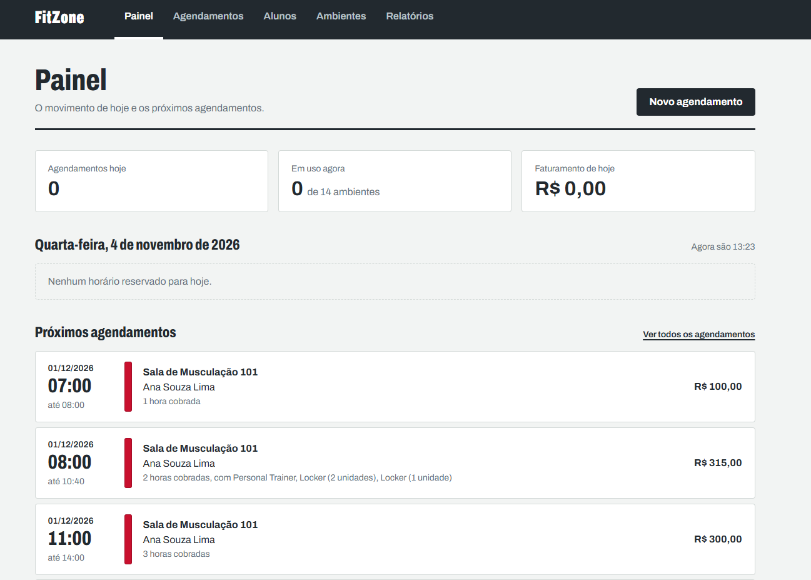
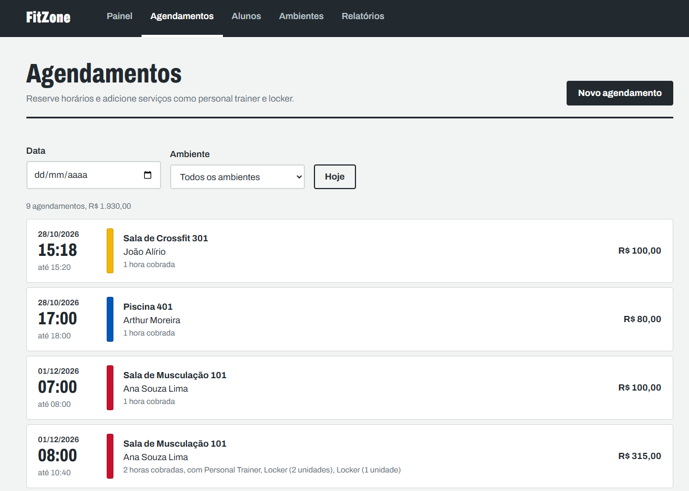
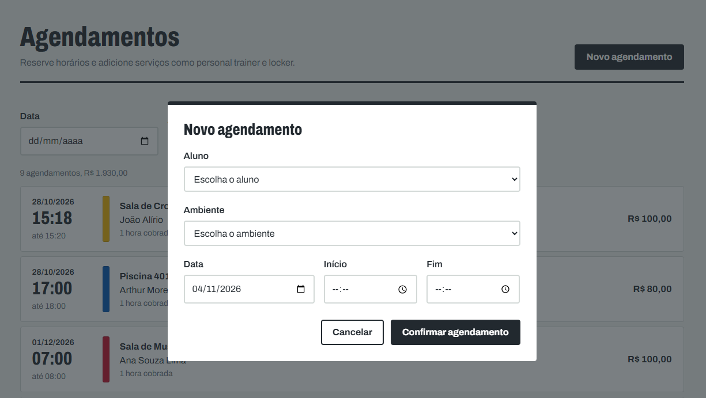
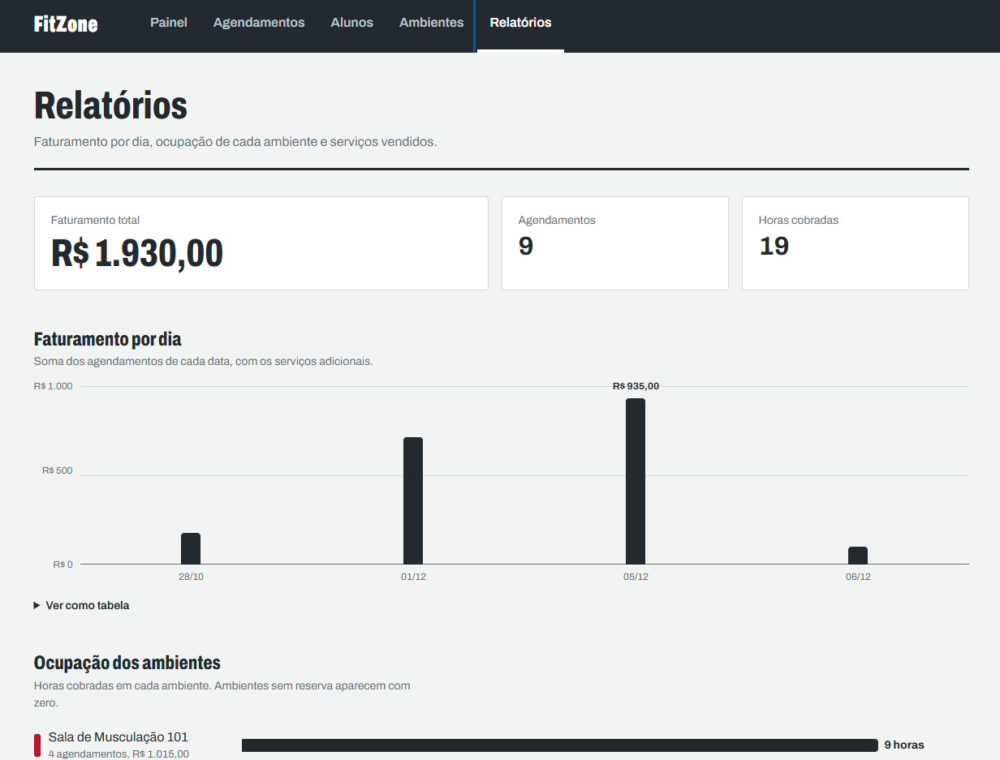
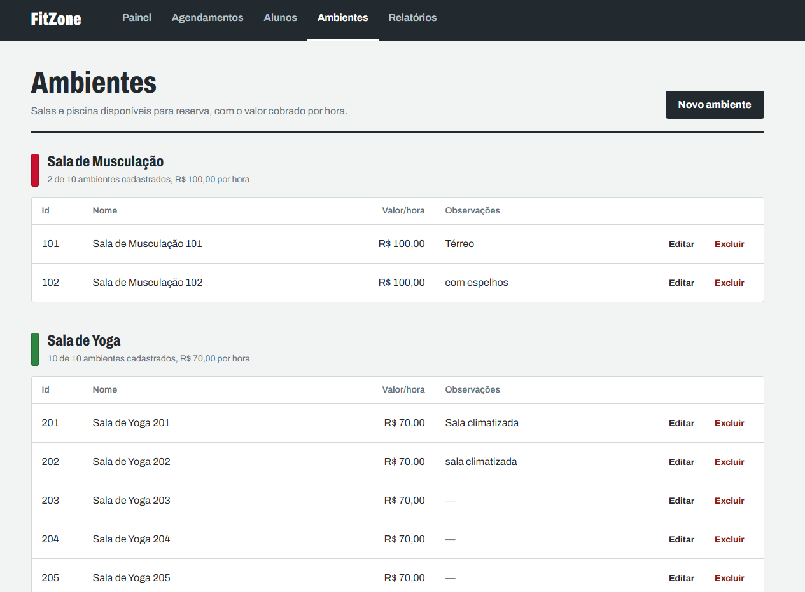
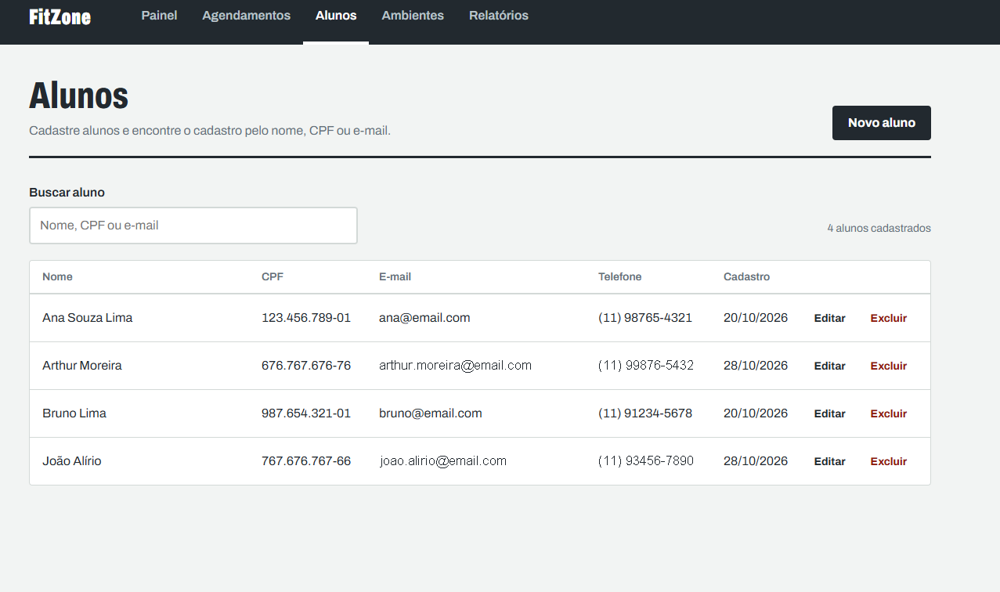
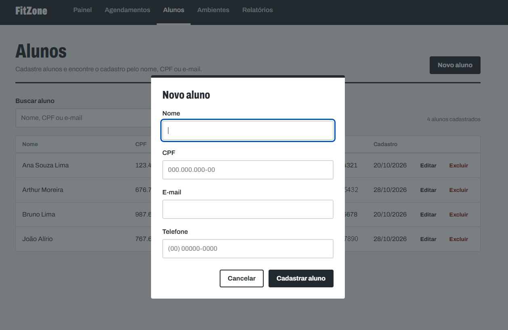
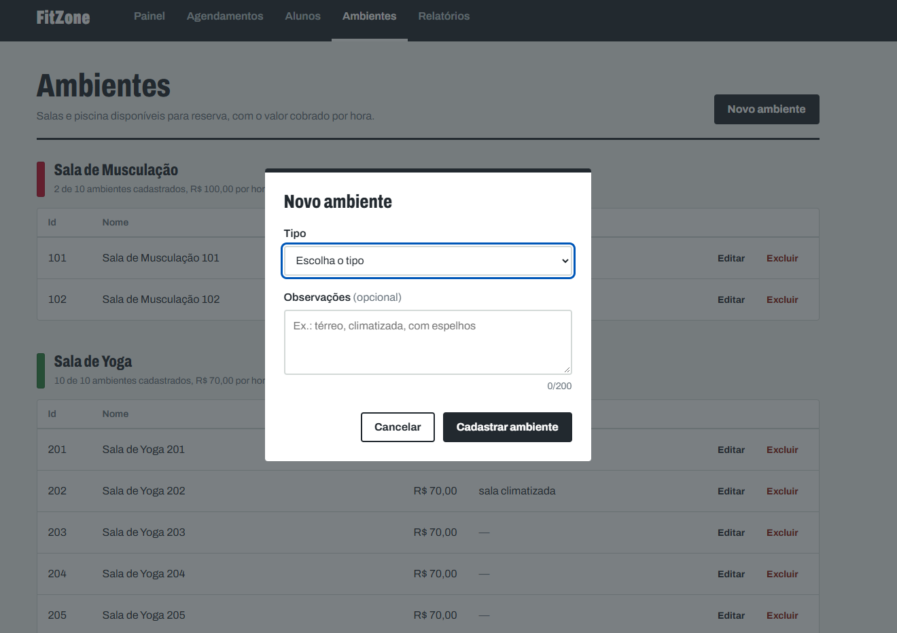
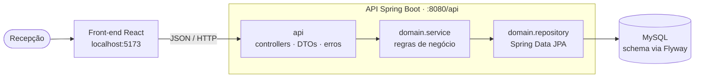
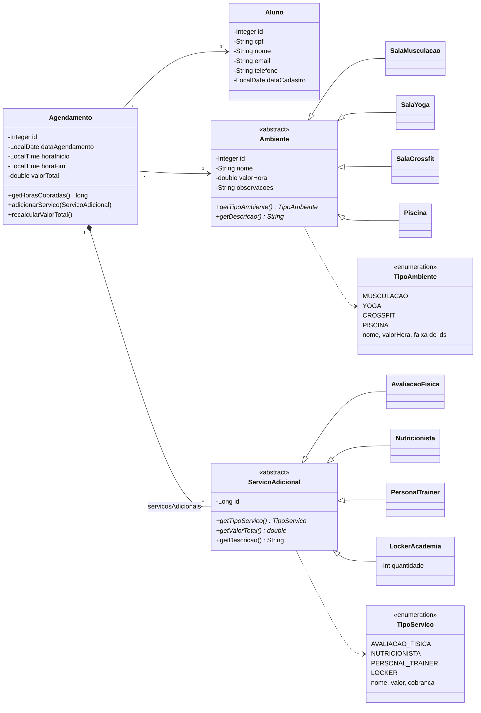

# FitZone — Sistema de Gestão de Academia

[](https://github.com/ArthurMoreira79/Projeto-FitZone/actions/workflows/ci.yml)


Sistema web para a recepção de uma academia: cadastro de alunos, reserva de ambientes (musculação, yoga, crossfit e piscina), serviços adicionais vendidos junto com a reserva (avaliação física, nutricionista, personal trainer e locker) e relatórios de ocupação e faturamento.

É uma **API REST em Spring Boot** com MySQL e um **front-end em React** que consome essa API. O projeto começou como um exercício de Orientação a Objetos em Java puro, rodando no console, e evoluiu em cinco fases até chegar aqui. Cada fase tem uma tag no Git, então dá para ver o código em qualquer etapa (veja [Evolução do projeto](#evolução-do-projeto)).

---

## Telas

**Painel**: o movimento do dia e os próximos agendamentos, com o valor e as horas cobradas de cada um.



| Agendamentos | Novo agendamento |
|---|---|
|  |  |
| **Relatórios** | **Ambientes** |
|  |  |
| **Alunos** | **Novo aluno** |
|  |  |
| **Novo ambiente** | |
|  | |

---

## O que o sistema faz

- **Painel do dia**: o que está acontecendo agora e os próximos agendamentos, atualizado a cada minuto.
- **Agendamentos**: lista filtrável por data e ambiente; ao criar um agendamento, o sistema mostra os horários já ocupados e a **prévia do valor** antes de salvar; no detalhe, dá para adicionar serviços ou cancelar.
- **Alunos**: busca por nome, CPF ou e-mail, cadastro e edição com máscaras de CPF e telefone.
- **Ambientes**: agrupados por tipo, com cadastro, edição de observações e exclusão.
- **Relatórios**: faturamento por dia, ocupação de cada ambiente e serviços vendidos, com gráficos e tabela alternativa.

Regras principais: só horas completas são cobradas (2h40 → 2h, mínimo de 1h), dois agendamentos não podem se sobrepor no mesmo ambiente e quem tem agendamento não pode ser excluído. Tabela de preços completa em [Regras de negócio e preços](#regras-de-negócio-e-preços).

---

## Destaques técnicos

Decisões que valem a pena olhar no código:

- **A regra de cobrança existe em um lugar só.** `Agendamento.getHorasCobradas()` define as horas cobradas. O valor da reserva, o personal trainer, os relatórios e a prévia do front usam esse método. O front não calcula preço: pede um orçamento à API, que monta um `Agendamento` temporário e não grava nada. A regra já esteve duplicada e isso gerou um bug de valores negativos nos relatórios (Fase 2); centralizar foi a correção.
- **Herança com polimorfismo de verdade no JPA.** `Ambiente` e `ServicoAdicional` são classes abstratas mapeadas com `SINGLE_TABLE`. Cada subtipo calcula o próprio valor (o locker cobra por unidade, o personal por hora). Os enums `TipoAmbiente` e `TipoServico` são a ficha técnica de cada tipo: nome, preço, faixa de ids e forma de cobrança.
- **O banco também protege as regras.** O schema é versionado com Flyway, e o Hibernate só valida (`ddl-auto=validate`). Constraints `CHECK` (horário, valores positivos, faixa de ids por tipo, quantidade de lockers), `UNIQUE` (CPF, e-mail) e FKs `ON DELETE RESTRICT` são a última barreira caso um bug passe pelos services.
- **Dinheiro em `BigDecimal`/`DECIMAL(10,2)`**, nunca em `double`: ponto flutuante binário não representa centavos exatamente e as somas dos relatórios acumulariam erro. Os preços nascem como texto nos enums (`new BigDecimal("70.00")`).
- **Conflito de horário resolvido no banco**, com uma consulta JPQL indexada, em vez de carregar todos os agendamentos na memória.
- **Camadas bem separadas.** `domain` (modelo, repositórios, services, exceções) não sabe que existe HTTP. `api` traz controllers, DTOs e tratamento de erros. Entidades JPA nunca saem no JSON: entrada e saída são `record`s validados com Bean Validation.
- **Erros previsíveis.** Um `@RestControllerAdvice` converte cada exceção no status certo (400, 404, 405, 409, 415, 500), sempre no mesmo formato JSON, com os campos inválidos. O front mostra essas mensagens direto em cada campo do formulário.
- **Dado pessoal fora da URL.** O aluno tem chave substituta (`id`); o CPF é só um campo `UNIQUE` e nunca aparece em path.
- **Front-end sem biblioteca de UI**, com cuidados de acessibilidade: modais com `<dialog>` nativo, erros ligados aos campos (`aria-invalid`, `aria-describedby`), avisos lidos por leitores de tela, gráficos com tabela alternativa e cores que nunca aparecem sem o nome do tipo ao lado (o par vermelho/verde reprova no teste de daltonismo).
- **Testes de integração** (29, JUnit 5 + `@SpringBootTest`) contra um MySQL real em um banco próprio (`fitzone_test`), com rollback em cada teste. Rodam a cada push no **GitHub Actions**, junto com o lint e o build do front. Também há uma coleção do Postman e um [roteiro de testes manuais](Roteiro.md).

---

## Arquitetura



### Modelo de domínio



- `Ambiente` e `ServicoAdicional` usam herança `SINGLE_TABLE`: uma tabela por hierarquia, com a coluna `tipo` como discriminador.
- Os serviços pertencem ao agendamento (composição): cancelar a reserva remove os serviços dela (`orphanRemoval` + `ON DELETE CASCADE`).
- O `PersonalTrainer` cobra pelas horas do agendamento ao qual pertence. O `LockerAcademia` cobra por unidade e é o único serviço com `quantidade`.

### Stack

| Camada | Tecnologias |
|---|---|
| Back-end | Java 21, Spring Boot 4 (Web, Data JPA, Validation), Hibernate, Maven Wrapper |
| Banco | MySQL 8, Flyway (5 migrations) |
| Front-end | React 19, Vite 8, React Router 8, JavaScript, CSS puro, oxlint |
| Testes e CI | JUnit 5, Spring Boot Test, Postman, GitHub Actions |

---

## Como rodar

**Pré-requisitos:** JDK 21, MySQL **8.0.16 ou mais novo** rodando localmente (versões anteriores aceitam as constraints `CHECK` mas não as aplicam) e, para o front-end, **Node.js 20 ou mais novo**. Não é preciso instalar o Maven: o projeto traz o Maven Wrapper (`mvnw`).

**1. Criar o banco** (só o banco, vazio — as tabelas são criadas pelo Flyway):

```sql
CREATE DATABASE fitzone;
```

**2. Configurar as credenciais**: copie o `.env.example` para `.env` na raiz do projeto e preencha:

```properties
DB_USERNAME=root
DB_PASSWORD=sua_senha_do_mysql
```

O `.env` está no `.gitignore` e nunca deve ser commitado. Se aparecer `Could not resolve placeholder 'DB_USERNAME'`, a aplicação foi executada fora da raiz do projeto e não encontrou o arquivo.

**3. Subir a API** (na raiz do projeto):

```bash
.\mvnw.cmd spring-boot:run
```

(No Linux/macOS: `./mvnw spring-boot:run`.) Na primeira execução, o Flyway aplica as migrations e cria as tabelas. A API fica em `http://localhost:8080/api`.

**4. Rodar os testes:**

```bash
.\mvnw.cmd test
```

Os testes usam o banco **`fitzone_test`**, criado automaticamente na primeira execução (profile `test`, em `src/test/resources/application-test.properties`). Cada teste roda numa transação desfeita no final, então o banco de testes fica sempre vazio e **o banco `fitzone` de desenvolvimento nunca é tocado**.

**5. Subir o front-end** (com a API rodando, em outro terminal):

```bash
cd frontend
npm install
npm run dev
```

O sistema abre em `http://localhost:5173`. O endereço da API está em `frontend/.env.development` (`VITE_API_URL`); se o front rodar em outra origem, ela precisa estar em `fitzone.cors.origens-permitidas`, no `application.properties`, senão o navegador bloqueia as requisições (erro de CORS no Console). Para conferir o código: `npm run lint`.

**6. Testar manualmente:** a coleção do Postman está em `postman/` e o checklist dos cenários em [Roteiro.md](Roteiro.md).

---

## API

| Recurso | Rotas |
|---|---|
| Alunos | `POST /api/alunos` · `GET /api/alunos` · `GET /api/alunos/{id}` · `GET /api/alunos/busca?cpf=` · `PUT /api/alunos/{id}` · `DELETE /api/alunos/{id}` |
| Ambientes | `POST /api/ambientes` · `GET /api/ambientes` · `GET /api/ambientes/{id}` · `PUT /api/ambientes/{id}` (só observações) · `DELETE /api/ambientes/{id}` · `GET /api/ambientes/tipos` |
| Agendamentos | `POST /api/agendamentos` · `GET /api/agendamentos?data=&ambienteId=&alunoId=` (filtros opcionais) · `GET /api/agendamentos/{id}` · `GET /api/agendamentos/orcamento?ambienteId=&horaInicio=&horaFim=` · `POST /api/agendamentos/{id}/servicos` · `DELETE /api/agendamentos/{id}/servicos/{servicoId}` · `DELETE /api/agendamentos/{id}` |
| Serviços | `GET /api/servicos/tipos` (catálogo: nome, preço e forma de cobrança) |
| Relatórios | `GET /api/relatorios/alunos/{id}` · `GET /api/relatorios/ambientes` · `GET /api/relatorios/faturamento` · `GET /api/relatorios/servicos` |

Exemplos de corpo:

```jsonc
// POST /api/alunos
{ "cpf": "12345678901", "nome": "Ana Souza", "email": "ana@email.com", "telefone": "11987654321" }

// POST /api/ambientes   (tipo: MUSCULACAO | YOGA | CROSSFIT | PISCINA)
{ "tipo": "YOGA", "observacoes": "Sala climatizada" }

// POST /api/agendamentos
{ "alunoId": 1, "ambienteId": 101, "data": "2026-12-01", "horaInicio": "08:00", "horaFim": "10:40" }

// POST /api/agendamentos/{id}/servicos   (tipo: AVALIACAO_FISICA | NUTRICIONISTA | PERSONAL_TRAINER | LOCKER)
{ "tipo": "LOCKER", "quantidade": 2 }
```

Todo erro volta no mesmo formato:

```json
{
  "status": 400,
  "titulo": "Dados inválidos",
  "mensagem": "Um ou mais campos estão inválidos. Corrija e tente novamente.",
  "caminho": "/api/alunos",
  "dataHora": "2026-10-20T16:30:00",
  "campos": [ { "nome": "cpf", "mensagem": "O CPF deve conter exatamente 11 dígitos, sem pontos ou traço" } ]
}
```

### Regras de negócio e preços

| Item | Valor |
|---|---|
| Sala de Musculação (ids 101–110) | R$ 100,00/h |
| Sala de Yoga (ids 201–210) | R$ 70,00/h |
| Sala de Crossfit (ids 301–310) | R$ 100,00/h |
| Piscina (ids 401–410) | R$ 80,00/h |
| Avaliação física | R$ 70,00 (fixo) |
| Nutricionista | R$ 80,00 (fixo) |
| Personal trainer | R$ 50,00 por hora cobrada do agendamento |
| Locker | R$ 5,00 por unidade |

- **Horas cobradas**: só horas completas (2h40 → 2h); reservas menores que 1 hora pagam 1 hora cheia.
- **Conflito de horário**: dois agendamentos no mesmo ambiente e dia não podem se sobrepor; horários "encostados" (8h–9h e 9h–10h) são permitidos.
- **Exclusão**: aluno ou ambiente com agendamentos não pode ser excluído (409, com a mensagem dizendo quantos agendamentos existem). Cancelar um agendamento remove os serviços dele; um serviço também pode ser removido sozinho, e o total é recalculado.
- **Ids de ambiente**: cada tipo tem uma faixa de 10 ids, e o cadastro usa o primeiro livre. Um id de ambiente excluído volta a ser usado, o que é seguro porque só se exclui ambiente sem agendamentos.

---

## Estrutura de pastas

<details>
<summary>Ver a árvore de pastas</summary>

```
Projeto-FitZone/
├── .env.example              # chaves de configuração (o .env real não é versionado)
├── frontend/                 # front-end React + Vite
│   ├── .env.development      # VITE_API_URL (endereço da API, não é segredo)
│   └── src/
│       ├── api/              # cliente HTTP central + um módulo por recurso
│       ├── avisos/           # Context dos avisos (useAviso)
│       ├── components/       # Layout, Modal, Botao, campos, gráficos, itens e modais de cada tela
│       ├── hooks/            # useDados (busca/recarga) e useAgora (relógio)
│       ├── pages/            # Painel, Agendamentos, Alunos, Ambientes, Relatorios, NaoEncontrada
│       ├── formatos.js       # moeda, CPF, telefone, datas e horas (sem armadilhas de fuso)
│       └── index.css         # tokens de cor e fonte, tabelas, campos e anilhas
├── postman/                  # coleção do Postman (testes manuais)
├── Roteiro.md                # checklist dos testes manuais
└── src/
    ├── main/
    │   ├── java/com/fitzone/
    │   │   ├── FitzoneApplication.java   # ponto de entrada Spring Boot
    │   │   ├── domain/
    │   │   │   ├── model/        # entidades JPA + enums TipoAmbiente e TipoServico
    │   │   │   ├── repository/   # interfaces Spring Data JPA
    │   │   │   ├── service/      # regras de negócio (@Service, @Transactional)
    │   │   │   └── exception/    # exceções de domínio (unchecked)
    │   │   └── api/
    │   │       ├── config/           # CorsConfig (origens liberadas para o front)
    │   │       ├── controller/       # @RestController por recurso
    │   │       ├── dto/              # records de request/response e dos relatórios
    │   │       └── exceptionhandler/ # ApiExceptionHandler + ErroResposta
    │   └── resources/
    │       ├── application.properties
    │       └── db/migration/     # migrations Flyway (V1..V5)
    └── test/
        ├── java/com/fitzone/domain/service/       # testes de integração dos services
        └── resources/application-test.properties  # profile de teste (banco fitzone_test)
```

</details>

---

## Evolução do projeto

O FitZone foi construído em fases, cada uma sobre a anterior já estável. Cada fase tem uma tag; o link abre o repositório como ele estava ao fim dela.

| Fase | Tag | O que mudou |
|---|---|---|
| 1 — Java puro | [`v1-poo`](https://github.com/ArthurMoreira79/Projeto-FitZone/tree/v1-poo) | Sistema de console com POO: validações de entrada, Javadoc e testes JUnit 5 |
| 2 — Banco de dados | [`v2-jpa`](https://github.com/ArthurMoreira79/Projeto-FitZone/tree/v2-jpa) | Arquivos `.dat` trocados por JPA/Hibernate + MySQL; conflito de horário consultado no banco |
| 3 — Console melhorado | [`v3-console`](https://github.com/ArthurMoreira79/Projeto-FitZone/tree/v3-console) | Cores ANSI, nova tentativa em vez de cancelar a operação, tabelas alinhadas |
| 4 — API REST | [`v4-spring-api`](https://github.com/ArthurMoreira79/Projeto-FitZone/tree/v4-spring-api) | Migração para Spring Boot, escrita à mão: Flyway, services, DTOs, tratamento de erros e testes de integração; o console foi removido |
| 5 — Front-end web | [`v5-web`](https://github.com/ArthurMoreira79/Projeto-FitZone/tree/v5-web) | Front-end React consumindo a API; endpoints de tipos e orçamento criados para o front |
| 6 — Portfólio | — | Este README, diagramas, tags por fase e acabamentos (em andamento) |

<details>
<summary><strong>Histórico detalhado de cada fase</strong> (o que foi feito, decisões e bugs encontrados)</summary>

### Fase 1 — Robustez e boas práticas (Java puro) ✔ (concluída)

✔ - Validações de entrada mais completas na camada de fronteira: formato de CPF, datas no passado, hora fim menor que hora início, quantidade de lockers negativa etc.
✔ - Javadoc nas classes principais (`AdministradorSistema`, `Agendamento`, `Ambiente`) — treina documentação de API, útil pra qualquer projeto futuro.
✔ - Testes automatizados com **JUnit 5** para a camada de controle, cobrindo as regras de negócio (sobreposição de horário, cálculo de valor total, exceções lançadas nos casos certos).
✔ - Centralizar tratamento de erro de entrada (cada menu repetia `try/catch` parecido) com um pequeno utilitário de leitura validada (`lerInteiro()`, `lerData()`) reaproveitável entre os menus.

### Fase 2 — Persistência com banco de dados relacional ✔ (concluída)

Trocar a serialização em `.dat` por um banco de verdade:

- ✔ Migrado de `ObjectOutputStream`/`ObjectInputStream` para **JPA/Hibernate + MySQL**.
- ✔ Tabelas modeladas em `sql/schema.sql`: `alunos`, `ambientes` (herança `SINGLE_TABLE`, coluna `tipo`), `agendamentos`, `servicos_adicionais` (herança `SINGLE_TABLE`, coluna `tipo`). *(Substituído por migrations Flyway na Fase 4.)*
- ✔ Repositórios reescritos com `EntityManager`, mantendo a mesma assinatura de métodos que o `AdministradorSistema` já usava (Repository Pattern na prática).
- ✔ `ServicoAdicional` convertida de interface para classe abstrata `@Entity` (decisão registrada: JPA não mapeia interfaces).
- ✔ ID de `Agendamento` passou de contador manual para `AUTO_INCREMENT` do MySQL.
- ✔ Otimizada a checagem de sobreposição de horário: `realizarAgendamento` não percorre mais todos os agendamentos em memória — agora usa `RepositorioAgendamentos.buscarConflitos(...)`, uma consulta JPQL que já filtra por ambiente/data/sobreposição direto no banco (normalmente retorna 0 ou 1 linha, em vez da tabela inteira).
- ✔ Roteiro de testes manuais (`Roteiro.md`) atualizado para a Fase 2.

**Bugs encontrados e corrigidos durante a validação da Fase 2** (achados testando o sistema de ponta a ponta contra o MySQL real, não eram específicos de JPA/Hibernate):
- `LeitorEntrada.lerHoraApos()` tinha a condição de validação invertida — aceitava hora de fim *anterior* à de início e rejeitava horários válidos. Corrigido.
- `AdministradorSistema.relatorioPorAmbiente()` calculava horas totais sem aplicar o piso mínimo de 1h (mesma regra já usada em `Agendamento.calculaValorTotal()`), o que gerava valores negativos no relatório quando um agendamento tinha fim antes do início (efeito colateral do bug acima). Corrigido para ficar consistente com a mesma regra.
- `hibernate.show_sql`/`hibernate.format_sql` desligados em `persistence.xml` — estavam poluindo o console com o SQL gerado a cada operação.

- **Decisão da época (revista na Fase 4)**: os testes do JUnit viraram testes de integração contra o MySQL real, no mesmo schema `fitzone` do desenvolvimento, e `mvn test` limpava as tabelas a cada execução. Um schema `fitzone_test` separado foi descartado porque exigiria manter dois schemas à mão. Com o Flyway criando as tabelas sozinho, esse custo sumiu — na Fase 4 os testes passaram a usar o `fitzone_test`.

### Fase 3 — Melhorias de interface (ainda em texto) ✔ (concluída)

- ✔ Cores ANSI no terminal (`ConsoleUtil`): vermelho para erro, verde para sucesso, amarelo para aviso; negrito + branco destacado para títulos, subtítulos e blocos de relatório.
- ✔ Validação de entrada com nova tentativa em vez de cancelar a operação inteira ao digitar algo errado, inclusive para CPF duplicado no cadastro de aluno, verificado assim que digitado.
- ✔ Pausa "Pressione ENTER para continuar" ao fim de cada operação, antes de voltar ao menu.
- ✔ Espaçamento padronizado entre mensagens comuns e mensagens de erro/sucesso/aviso (resolvido direto nos métodos do `ConsoleUtil`).
- ✔ Tabelas de listagem realinhadas e blocos do relatório de faturamento padronizados no estilo `===== TEXTO =====`.
- Não feito, opcional: **Lanterna**/**JLine** para menus mais ricos — ficou obsoleto, porque a interface de console foi removida na Fase 4.

### Fase 4 — API REST com Spring Boot ✔ (concluída)

A migração foi feita **à mão, passo a passo**, a partir do código da Fase 3, e aproveitou para revisar várias decisões.

**Estrutura e infraestrutura**
- ✔ Projeto gerado pelo Spring Initializr (Spring Boot 4, Java 21, Maven Wrapper) e código movido para o pacote base `com.fitzone`, organizado em `domain` e `api`.
- ✔ Credenciais em `.env` (fora do Git), importado pelo `application.properties`; o `.env.example` documenta as chaves.
- ✔ **Flyway**: o `schema.sql` aplicado à mão virou 4 migrations versionadas. Regra adotada: migration já aplicada nunca é editada — correções vão numa migration nova.
- ✔ Interface de console (`fronteira/`, `Main.java`) e persistência manual (`controle/`, `JPAUtil`, `persistence.xml`) removidas — o sistema agora é só API.

**Modelo e banco**
- ✔ `Aluno` ganhou **chave substituta** (`id INT AUTO_INCREMENT`); o CPF virou campo `UNIQUE`. Assim o CPF pode ser corrigido sem mexer em FKs e não aparece nas URLs da API (dado pessoal).
- ✔ `Ambiente.id` passou de `VARCHAR` para `INT`: o `MAX` do próximo id deixou de comparar texto (`"99" > "101"`) e as conversões `parseInt`/`valueOf` sumiram.
- ✔ Faixa de ids reduzida para **10 por tipo** (101–110, 201–210, 301–310, 401–410), garantida pelo enum `TipoAmbiente` e por uma constraint `CHECK` no banco.
- ✔ Constraints `CHECK` para horário (`fim > início`), valores positivos, tipos válidos e quantidade de lockers; índice para a consulta de conflito de horário.
- ✔ E-mail e telefone do aluno passaram a ser obrigatórios, e o e-mail, único.

**Regras de negócio revisadas**
- ✔ **Cobrança por hora completa**: só horas inteiras contam (2h40 → 2h), com mínimo de 1 hora. A regra ficou centralizada em `Agendamento.getHorasCobradas()`, usada no valor, no personal trainer e nos relatórios — a duplicação dessa regra foi a causa do bug de relatório da Fase 2.
- ✔ **Personal trainer cobrado por hora** do agendamento (antes era valor fixo, apesar do Javadoc dizer "por hora").
- ✔ Reagendar = cancelar + criar outro (não existe PUT de agendamento, de propósito: mudar o horário exigiria recalcular valor e checar conflito).

**Camadas**
- ✔ Repositórios viraram interfaces **Spring Data JPA**, com query methods (`existsByCpf`, `findByAluno_Id...`) e `@Query` para o conflito de horário e o `TYPE()` da herança.
- ✔ `AdministradorSistema` dividido em 4 `@Service` (`AlunoService`, `AmbienteService`, `AgendamentoService`, `RelatorioService`) com `@Transactional`.
- ✔ Exceções de domínio viraram **unchecked** (`RuntimeException`) — com exceção checked, o `@Transactional` não faz rollback. `FalhaPersistenciaException` foi removida (o Spring traduz erros de banco em `DataAccessException`).
- ✔ DTOs (records) com Bean Validation; controllers REST com 201 + `Location` no POST, 204 no DELETE e CRUD completo de alunos e ambientes.
- ✔ `ApiExceptionHandler` agrupando as exceções por categoria de status.

**Testes**
- ✔ 18 testes de integração dos services rodando no banco `fitzone_test` (criado automaticamente), com rollback ao fim de cada teste.
- ✔ Coleção do Postman versionada em `postman/`, com caminho feliz e casos de erro.

### Fase 5 — Front-end web com React ✔ (concluída)

Escolhida a "Opção B": o Spring Boot continua como API REST e o front-end é um projeto separado, na pasta `frontend/` do mesmo repositório.

**Ligação front ↔ back**
- ✔ **CORS** configurado no Spring (`api/config/CorsConfig`), com as origens permitidas no `application.properties` (`fitzone.cors.origens-permitidas`) e o header `Location` exposto ao JavaScript.
- ✔ URL da API no front via `frontend/.env.development` (`VITE_API_URL`) — só endereço, nunca credencial: tudo que vai para o front é público.
- ✔ Cliente HTTP central que trata 204 sem corpo, falha de conexão (status 0) e o `ErroResposta` da API; um módulo por recurso em `src/api/`.

**Mudanças no back feitas para o front**
- ✔ `TipoAmbiente` e `TipoServico` viraram a "ficha técnica" de cada tipo (nome, preço e, nos serviços, a forma de cobrança `FIXO` / `POR_HORA` / `POR_UNIDADE`). Os preços saíram das subclasses; o cálculo continua polimórfico. Endpoints `GET /api/ambientes/tipos` e `GET /api/servicos/tipos`.
- ✔ Responses com o **código** do enum (`"YOGA"`) ao lado do texto de exibição (`"Sala de Yoga"`): o front decide pelo código, nunca pelo texto.
- ✔ Listagem de agendamentos com filtros opcionais (`?data=&ambienteId=&alunoId=`), ordenada por data e hora.
- ✔ **Orçamento** (`GET /api/agendamentos/orcamento`): prévia do valor calculada pelo próprio `Agendamento`, sem gravar nada — a regra de cobrança não foi duplicada no JavaScript.
- ✔ Relatório de ocupação com código do tipo e valor faturado por ambiente; relatório de serviços agrupado pelo enum (antes mostrava o nome da classe Java, como `LockerAcademia`).
- ✔ Corrigidos no caminho: mensagens sem espaço ("tipo YOGAatingido"), "Locker (1 unidades)" e o nome da Piscina sem número.

**Front-end**
- ✔ Layout com navegação no topo, componentes reutilizáveis (`Botao`, `Modal`, `ModalConfirmacao`, `CampoTexto`, `MensagemErro`, avisos via Context) e os hooks `useDados` (busca com recarga e descarte de respostas atrasadas) e `useAgora` (relógio que avança a cada minuto).
- ✔ As cinco telas descritas no estado atual, com filtros na URL (F5 e links mantêm o que foi escolhido).
- ✔ Datas tratadas sem `toISOString()`/`new Date("AAAA-MM-DD")`, que convertem para UTC e mostrariam o dia errado no fuso de Brasília.
- ✔ Gráficos feitos em HTML/CSS: barras de uma cor só (as cores das anilhas reprovaram no teste de daltonismo e ficaram só como marca ao lado do nome), valor no maior dia, dica ao passar o mouse ou focar com Tab e tabela alternativa.

### Fase 6 — Portfólio (em andamento)

- ✔ Histórico do Git organizado com uma tag por fase (`v1-poo`, `v2-jpa`, `v3-console`, `v4-spring-api`, `v5-web`).
- ✔ README reescrito para quem chega no repositório pela primeira vez: o que o sistema faz, destaques técnicos, diagrama de arquitetura e de classes (Mermaid); o histórico das fases ficou nesta seção recolhida.
- ✔ Prints das telas em `docs/img/`.
- ✔ Dinheiro em `DECIMAL(10,2)` / `BigDecimal` (migration V5): `valor_hora` e `valor_total` eram `DOUBLE`.
- ✔ Excluir aluno/ambiente com agendamentos responde com mensagem clara (`RegistroEmUsoException`, 409) em vez do genérico "Conflito de integridade" do banco.
- ✔ Ids de ambiente excluído voltam a ser usados (primeiro id livre da faixa, em vez de `MAX + 1`).
- ✔ Remover um serviço do agendamento: `DELETE /api/agendamentos/{id}/servicos/{servicoId}` e botão **Remover** no detalhe.
- ✔ CI no GitHub Actions: testes de integração com MySQL e lint + build do front a cada push.

</details>

---

## Limitações conhecidas

Pontos identificados nas Fases 4 e 5 e deixados conscientemente para depois (os que foram resolvidos na Fase 6 estão no histórico):

- [ ] **Relatórios agregam em memória** (`findAll()` + streams). Suficiente para o volume atual; com muitos dados, o ideal é consultas com `GROUP BY` no banco.
- [ ] **Relatórios sem filtro de período**: o faturamento por dia mostra só os dias com movimento, igualmente espaçados. Um parâmetro de datas em `/relatorios/faturamento` permitiria "últimos 30 dias" com os dias vazios aparecendo como zero.
- [ ] **Sem autenticação**: o front é um painel administrativo aberto. Login (Spring Security + JWT) fica para quando houver mais de um tipo de usuário.
- [ ] **Listas carregadas inteiras** (alunos, agendamentos) e filtradas no navegador. Ótimo para o volume de uma academia; com milhares de registros, o caminho é paginação na API.

---

## Ideias para o futuro

Possíveis expansões, ainda sem fase definida:

- **Nova identidade visual**: rever a paleta do sistema e as cores das anilhas que identificam os tipos de ambiente (hoje vermelho, verde, amarelo e azul; o par vermelho/verde não é distinguível para daltônicos, por isso a cor nunca aparece sozinha).
- **Site institucional** da academia: apresentação, modalidades, ambientes, preços e contato, para o público.
- **Página do aluno**: o aluno acompanha os próprios agendamentos, monta os treinos e organiza a rotina.
- **Página do professor**: o professor analisa as avaliações físicas dos alunos e entrega treinos personalizados.

As três páginas novas pedem **autenticação com perfis** (recepção/gestão, aluno, professor) e regras de acesso por perfil na API — provavelmente o primeiro passo de qualquer uma delas.
